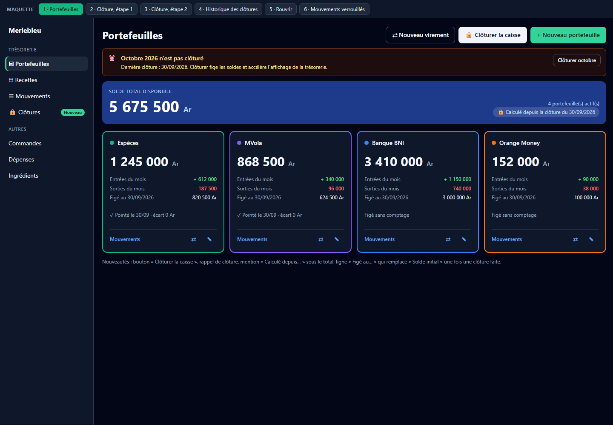
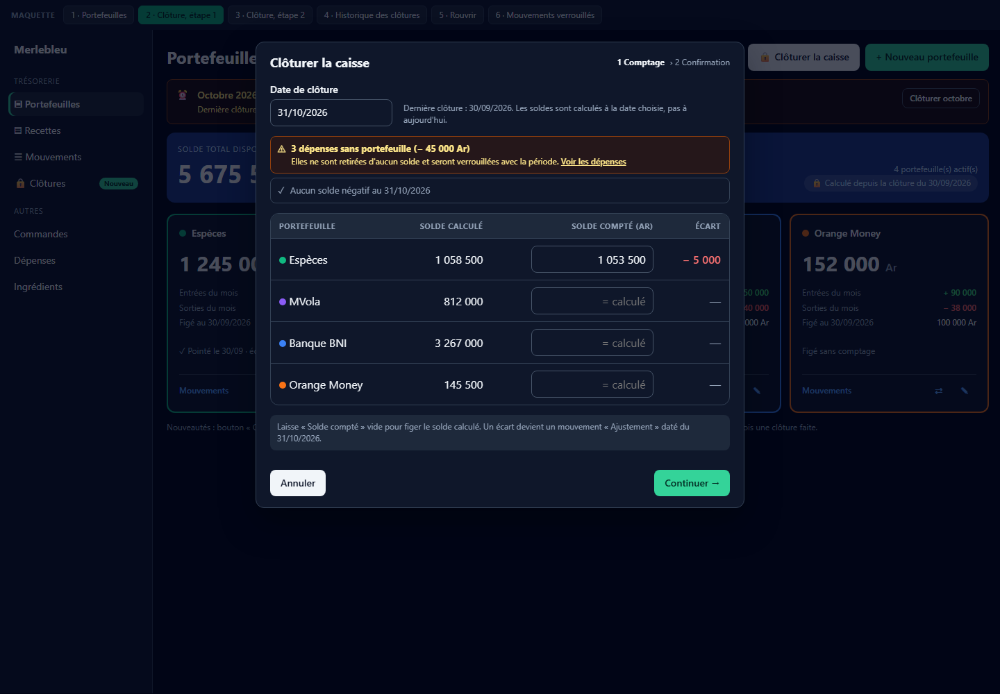
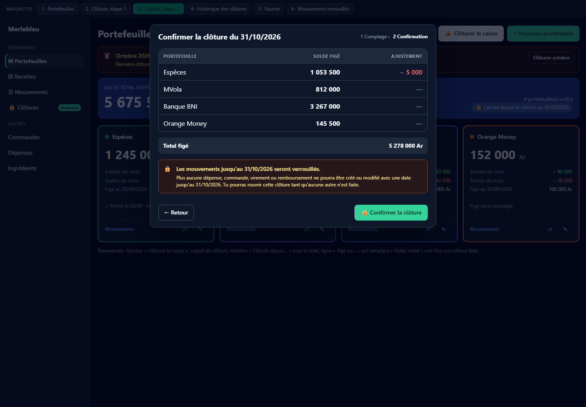
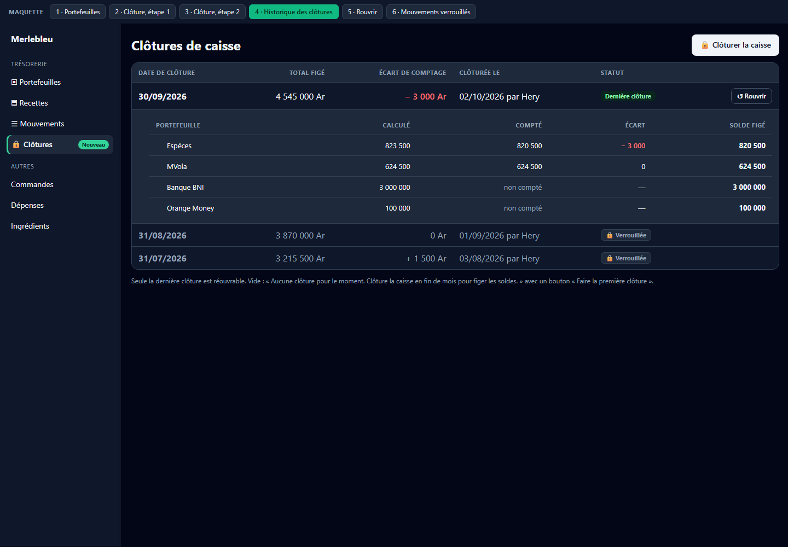
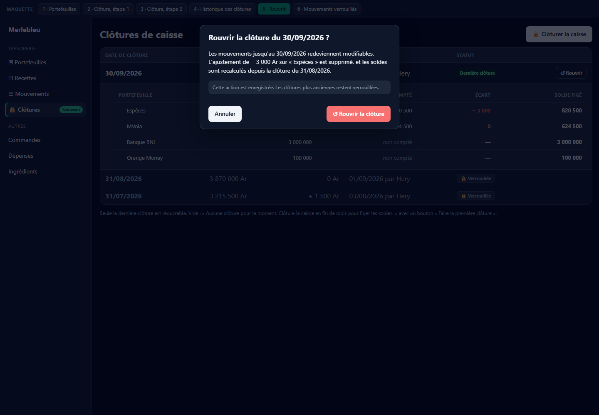
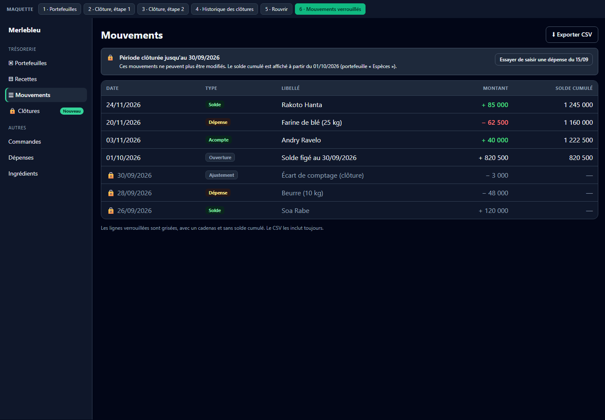

# Clôture de caisse : plan d'implémentation

Slug : `cash-closing`. Document issu d'une session de brainstorming, aucun code n'a été écrit.

## Objectif

Le solde de chaque portefeuille est aujourd'hui calculé à partir de tout l'historique via `MOVEMENTS_CTE` ([treasury.sql.ts](../../../packages/merlebleu-api/src/features/treasury/treasury.sql.ts)). Le coût augmente avec le temps. La clôture de caisse fige, à une date donnée, le solde de chaque portefeuille. Les soldes sont ensuite calculés à partir de ce solde figé et des seuls mouvements postérieurs.

## Synthèse

### Points compris
- **C1** : une clôture fige un solde par portefeuille à une date donnée.
- **C2** : solde courant = solde figé + mouvements postérieurs à la clôture.
- **C3** : écritures réservées à l'admin, lecture ouverte à tous les rôles.
- **C4** : le solde figé est le montant compté, ou le solde calculé si aucun comptage n'est saisi.
- **C5** : plus aucune création ni modification de mouvement daté jusqu'à la dernière clôture (dépense, commande, virement, remboursement, paiement d'une dépense fixe).
- **C6** : clôture manuelle par l'admin, avec choix de la date.
- **C7** : seule la dernière clôture peut être rouverte.
- **C8** : une date de clôture globale pour tous les portefeuilles actifs.
- **C9** : un écart de comptage devient un mouvement `ADJUSTMENT` daté de la clôture.
- **C10** : l'historique reste visible, mais le solde cumulé n'est affiché que pour la période ouverte.

### Hypothèses (validées)
- **H1** : le modèle n'a pas de notion de caisse espèces, donc le comptage est facultatif pour tous les portefeuilles. Un comptage vide signifie « figer le solde calculé ».
- **H2** : les portefeuilles archivés sont figés avec leur solde calculé, sans comptage.
- **H3** : un portefeuille créé après la clôture n'est pas concerné, et son `openingDate` reste inchangé.
- **H4** : la date de clôture est ≤ aujourd'hui et strictement postérieure à la clôture précédente.
- **H5** : clôture et réouverture se font en transaction. La clôture recalcule les soldes à la validation et refuse (409) si un mouvement est apparu depuis l'aperçu.
- **H6** : les dépenses sans portefeuille sont signalées par A3 mais ne sont pas figées.

### Améliorations
- **Retenues** : A1 (rappel de clôture), A2 (historique des clôtures), A3 (contrôles avant clôture), A4 (aperçu en deux étapes).
- **Reportée** : A5 (export CSV d'une clôture).

### Points de vigilance
- **V1** : le gain de performance dépend du filtrage de date dans les 6 branches du CTE et des index. À mesurer avant et après.
- **V2** : une commande avant clôture et livrée après a un acompte figé et un solde ouvert (correct). Modifier l'acompte ou annuler avec remboursement antidaté est bloqué.
- **V3** : couplage avec les modules `sale` et `expense` via `assertPeriodOpen`.
- **V5** : l'UI explique que « clôturer verrouille les mois passés ».
- **V6** : concurrence, transaction et verrou.
- **V7** : contrôle des dates (H4).
- **V8** : une dépense fixe payée après la clôture mais datée avant est refusée avec un message clair.
- **V9** : la réouverture supprime la clôture et son ajustement dans une transaction.
- **V10** : premier démarrage avec `synchronize: true`, à tester.
- **V11** : permissions, clôture et réouverture réservées à l'admin.

### Hors périmètre
Export CSV de clôture (A5), clôture automatique planifiée, clôture par portefeuille, solde cumulé sur les périodes clôturées, réouverture d'une clôture plus ancienne que la dernière.

## Plan d'implémentation

Ordre d'exécution : 1 → 2 → 3 → 4 → 5. Chaque étape dépend de la précédente.

### 1. `@merlebleu/shared` (C1, C4, C9, A2, A3)
- Ajouter `MovementType.ADJUSTMENT`.
- Créer `CashClosing`, `CashClosingLine`, `ClosingPreview` (soldes calculés par portefeuille et contrôles A3 : soldes négatifs, dépenses sans portefeuille).
- Créer `createClosingSchema` : `date` et `counts: [{ walletId, calculatedAmount, countedAmount? }]`. Les dates suivent le pattern `preprocess` de [docs/shared.md](../../shared.md).
- Ajouter `lastClosingDate` et `frozenAmount` à `Wallet`.
- Lancer `npm run generate:barrels`.
- Réutiliser les types existants `Wallet`, `Movement`, `MovementType`. Vérifier l'emplacement du domaine treasury dans `src/domain/`.

### 2. API : données et calcul (C2, V1, V10)
- **Entités** dans [treasury.entity.ts](../../../packages/merlebleu-api/src/features/treasury/treasury.entity.ts) : `cash_closings` (date unique, `createdAt`, `createdBy`) et `cash_closing_lines` (`walletId`, `calculatedAmount`, `countedAmount` nul, `frozenAmount`). Créées par `synchronize`, sans migration.
- **`treasury.sql.ts`** :
  - Chaque branche du CTE filtre `date > COALESCE((SELECT MAX(date) FROM cash_closings), '0001-01-01')`. Les appelants de `MOVEMENTS_CTE` ne changent pas.
  - La branche `OPENING` reprend `frozenAmount` de la dernière clôture. L'ouverture manuelle ne compte que si `openingDate` est postérieure à la clôture (H3).
  - `ADJUSTMENT` provient des lignes de clôture. Il apparaît dans l'historique mais pas dans les soldes, car déjà inclus dans `frozenAmount`. Il est exclu de `INCOME_TYPES_SQL` et `OUTFLOW_TYPES_SQL`.
- **Liste des mouvements et export CSV** : variante sans fenêtre pour la partie antérieure à la clôture, `running` nul avant la dernière clôture (C10).
- **Index** : vérifier ceux sur `orderDate`, `balancePaidDate`, `deliveryDate` et `expenses.date`.
- Risque : double comptage de l'ajustement, d'où les tests de l'étape 5 sur un jeu de données de référence.

### 3. API : endpoints et verrouillage (C3, C5, C7, V3, V6 à V9, V11)
- **Endpoints** :
  - `GET /treasury/closings` (tous rôles).
  - `GET /treasury/closings/preview?date=` (admin).
  - `POST /treasury/closings` (admin).
  - `DELETE /treasury/closings/last` (admin).
  - DTO via `nestjs-zod`, documentation Swagger.
- **Transaction** : `pg_advisory_xact_lock`, recalcul des soldes, 409 si `calculatedAmount` a changé depuis l'aperçu (H5).
- **Garde `assertPeriodOpen(date)`** : dans le module treasury, exportée, appelée par :
  - les commandes : `orderDate`, `balancePaidDate`, livraison, annulation et remboursement ;
  - les dépenses : `date` et paiement d'une dépense fixe ;
  - les virements, les remboursements et les pointages.
- **Erreur de verrouillage** : message de la maquette (« Cette date est avant la clôture du … »).
- Fichiers existants à réutiliser : `treasury.service.ts`, `treasury.controller.ts` (décorateur `@Roles(UserRole.ADMIN)`), `treasury.dto.ts`.

### 4. App `@merlebleu/ui` (A1 à A4, V5)

- **Routes et menu** : route lazy `/treasury/closings` dans `treasury.routes.ts` et entrée « Clôtures » dans [app-layout.ts](../../../packages/merlebleu-app/src/app/app-layout.ts).
- **`closing-dialog`** (2 étapes) : s'inspire de `cash-count-dialog` (mêmes `p-dialog`, `p-inputnumber`, `p-datepicker`).
- **`wallet-list`** : bouton « Clôturer la caisse », bandeau de rappel (A1), mention « Calculé depuis… », ligne « Figé au… » à la place de « Solde initial ».
- **`closing-list`** (A2) : détail par portefeuille et réouverture avec confirmation.
- **`movement`** : lignes verrouillées grisées, solde cumulé uniquement pour la période ouverte.
- **Service** : nouvelles méthodes dans `treasury-api.service.ts`. Les erreurs 409 et de verrouillage passent par `httpErrorInterceptor` (toast).

### 5. Tests et vérification
- **Jest** `treasury.service` : aperçu, clôture, écart, réouverture, date invalide (H4), 409, garde de période.
- **Jest** `treasury.sql` : même solde avant et après clôture sur un jeu de données de référence, absence de double comptage de l'ajustement.
- **e2e API** : clôturer, puis tenter d'écrire une dépense verrouillée (refusée), puis rouvrir et réessayer (acceptée).
- **Karma** : utilitaires du modèle.
- **Performance (V1)** : mesurer la requête des soldes avant et après sur un jeu de données volumineux.
- **Vérification** : `npm run lint`, `npm run build`, puis smoke test dans le navigateur.

## Maquettes finales

Aperçu interactif (privé, potentiellement éphémère) : https://claude.ai/artifact/4tuUfrBuSiEZst6zwCkzsV. Les fichiers HTML et PNG du dépôt font foi : [cash-closing.html](mockups/cash-closing.html).

| Écran | Image |
|---|---|
| Portefeuilles (rappel, bouton, solde figé) |  |
| Clôture, étape 1 (comptage, contrôles) |  |
| Clôture, étape 2 (confirmation) |  |
| Historique des clôtures |  |
| Rouvrir la dernière clôture |  |
| Mouvements verrouillés |  |

Notes sur les maquettes :
- La couleur primaire (émeraude) suppose le preset Aura par défaut, à confirmer à l'implémentation.
- État vide de l'historique : « Aucune clôture pour le moment », avec un bouton « Faire la première clôture ».
- Les PNG sont en thème sombre, car la capture headless suit le thème du système.
