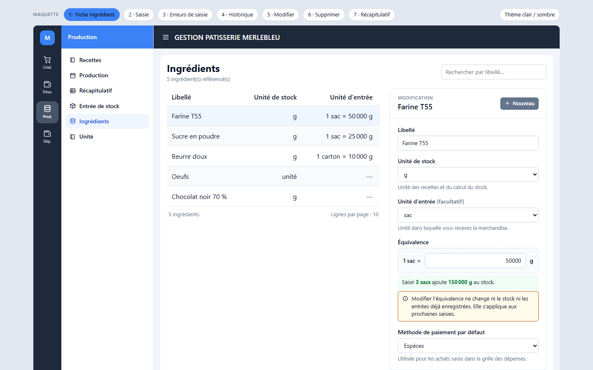
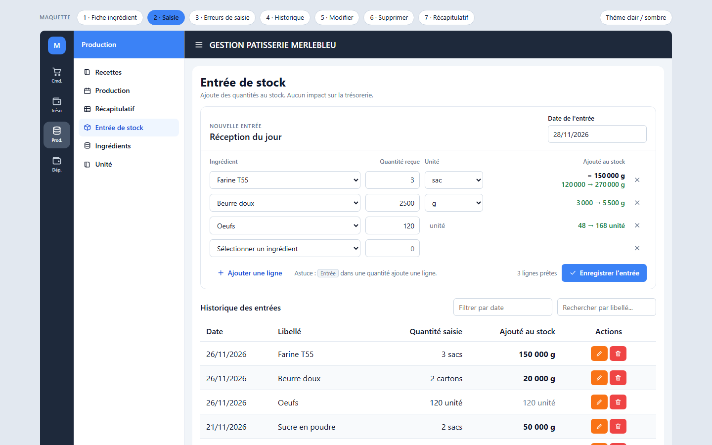
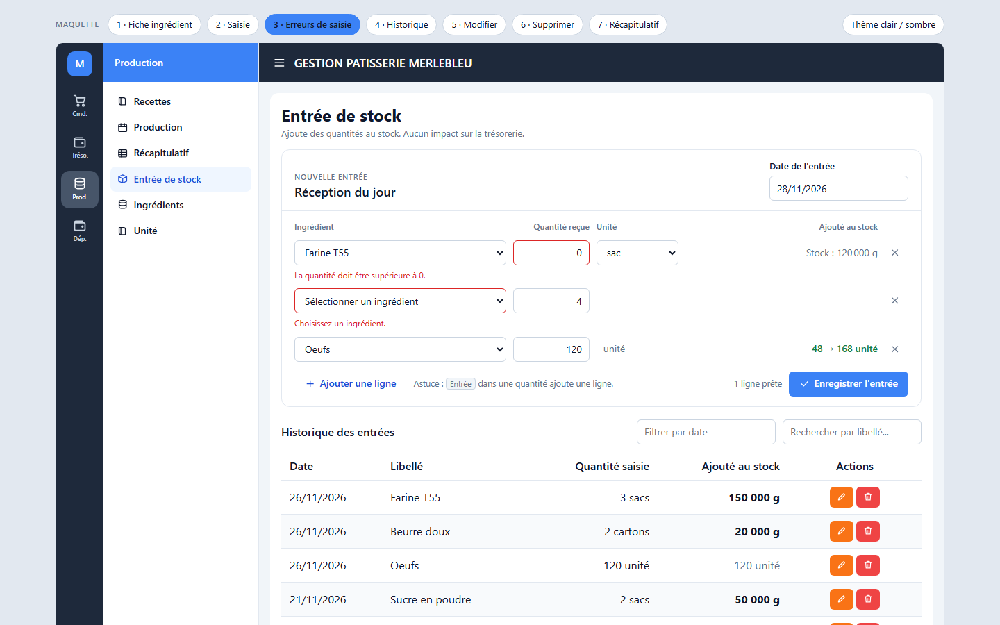
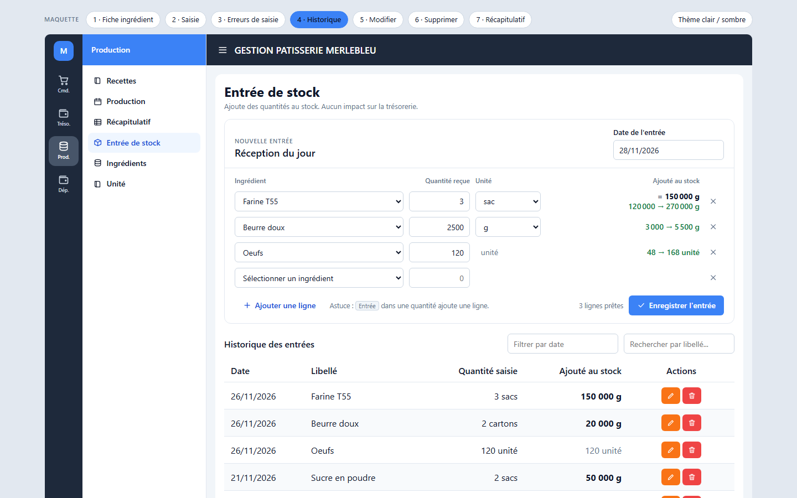
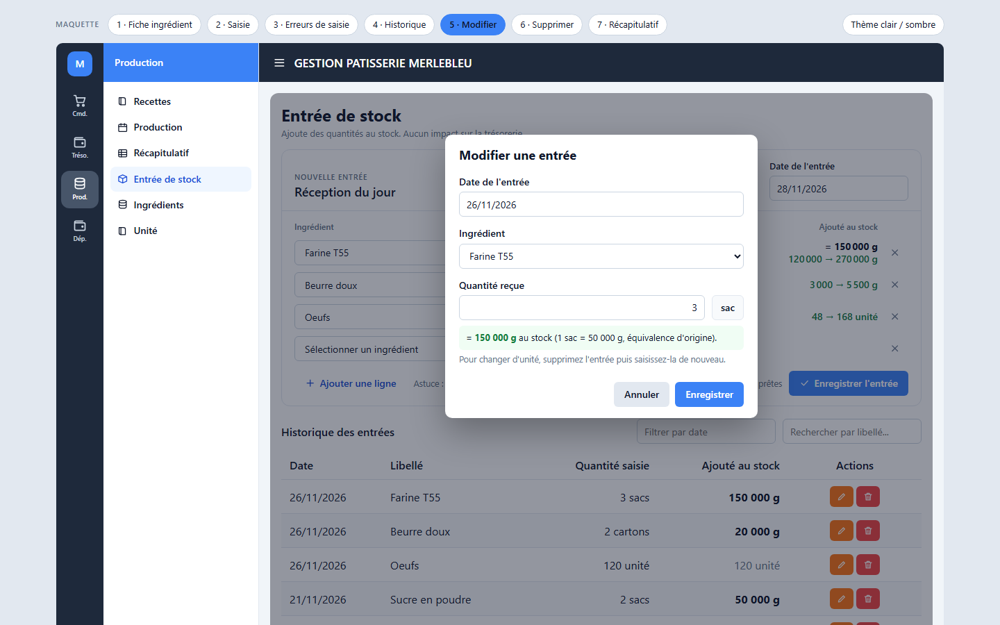
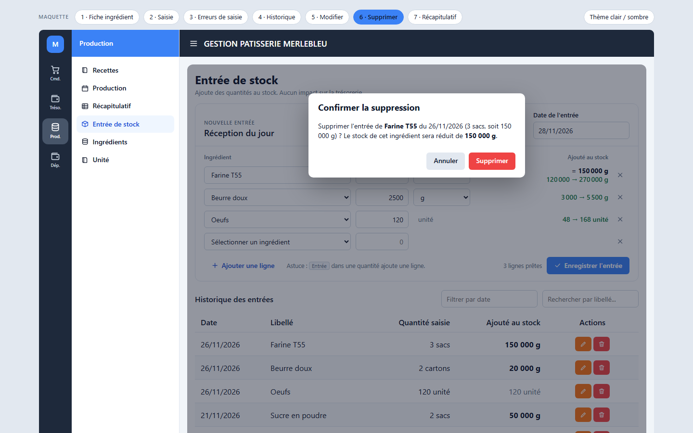
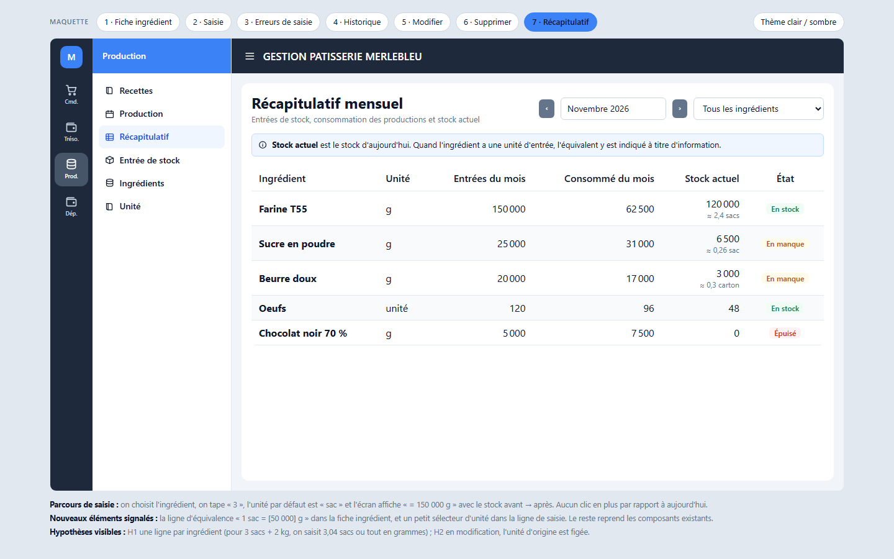

# Unité d'entrée et unité de stock des ingrédients

Gérer deux unités par ingrédient : l'**unité de stock** (recettes, production, calcul du stock) et l'**unité d'entrée** (saisie des arrivées de stock), reliées par une formule de conversion automatique. Exemple : la farine est en grammes dans les recettes, mais on saisit des sacs, et 1 sac = 50 kg = 50 000 g.

## Synthèse

### Points compris
- **C1** : deux unités par ingrédient. Unité de stock pour les recettes, la production et le stock. Unité d'entrée pour la saisie des arrivées.
- **C2** : la conversion entrée → stock est automatique, avec un facteur par ingrédient (1 sac = 50 000 g).
- **C3** : les recettes et la production ne changent pas (déjà en unité de stock : `RecipeLine.quantity` dans `recipe.ts`).
- **C4** : la formule est propre à chaque ingrédient (un sac de farine et un sac de sucre n'ont pas le même poids).
- **C5** : on conserve la quantité saisie et la quantité convertie, avec le facteur utilisé à ce moment.
- **C6** : l'unité d'entrée est optionnelle. Sans elle, l'ingrédient se saisit en unité de stock comme aujourd'hui.
- **C7** : une seule unité d'entrée par ingrédient.

### Décisions
- **D1** : l'unité d'entrée est choisie dans la table `ingredient_units` existante. L'ingrédient reçoit `entryUnit` (nullable) et `entryUnitFactor` (nullable, décimal).
- **D2** : une entrée de stock reçoit 3 colonnes nullables (A6) : quantité saisie, libellé de l'unité saisie, facteur utilisé. `quantity` reste la quantité convertie en unité de stock. Le stock et le récapitulatif mensuel ne changent donc pas.
- **D3** : chaque ligne de saisie propose « unité d'entrée » (par défaut) ou « unité de stock ».
- **D4** : le calcul est fait côté API (source de vérité) : `quantity = arrondi(saisie × facteur, 2 décimales)`. L'interface n'affiche qu'un aperçu.
- **D5** : à la modification, on garde le facteur d'origine. À la suppression, on retire la quantité convertie enregistrée.
- **D6** : les entrées existantes (colonnes `NULL`) se lisent comme saisies en unité de stock, sans script de reprise.

### Hypothèses
- **H1** : la règle « un ingrédient une seule fois par lot » reste. Pour 3 sacs + 2 kg en vrac, on saisit une seule quantité (3,04 sacs) ou tout en grammes.
- **H2** : si l'on change l'ingrédient d'une entrée en modification, elle repasse en unité de stock du nouvel ingrédient. L'unité d'une entrée n'est pas modifiable (supprimer puis resaisir).
- **H3** : la suppression d'une unité utilisée comme unité d'entrée met `entryUnit` à `NULL` (`onDelete: SET NULL`). L'historique reste lisible grâce au libellé enregistré.

### Hors périmètre
- Plusieurs unités d'entrée par ingrédient.
- Conversion rétroactive du stock ou des recettes.
- Prix, fournisseur, lien avec la trésorerie.
- Table de conversions globale.

## Registre final

| ID | Type | Point |
|---|---|---|
| C1-C7 | Compris | voir ci-dessus |
| D1-D6 | Décision | voir ci-dessus |
| H1-H3 | Hypothèse | voir ci-dessus |
| A1 | Amélioration (retenue) | Aperçu en direct « 3 sacs = 150 000 g » et stock avant → après sur chaque ligne |
| A2 | Amélioration (retenue) | Validation Zod : unité d'entrée et facteur ensemble, facteur > 0, unité différente de l'unité de stock |
| A3 | Amélioration (retenue) | Historique : « Quantité saisie » et « Ajouté au stock » |
| A4 | Amélioration (retenue) | Avertissement dans la fiche ingrédient : modifier le facteur n'affecte pas l'historique |
| A5 | Amélioration (retenue) | Tests Jest : conversion, delta avec le facteur d'origine, entrée sans unité d'entrée |
| A6 | Amélioration (retenue) | Libellé de l'unité saisie enregistré dans l'entrée |
| A7 | Amélioration (retenue) | « ≈ 2,4 sacs » sous le stock actuel du Récapitulatif (la liste des ingrédients n'affiche pas de stock) |
| V1 | Vigilance | Changer l'unité de stock d'un ingrédient ne convertit ni le stock ni les recettes (risque existant) |
| V2 | Vigilance | Le récapitulatif mensuel somme les quantités converties, il est inchangé |
| V3 | Vigilance | Suppression d'une unité utilisée comme unité d'entrée (voir H3) |
| V4 | Vigilance | Anciennes entrées à colonnes `NULL` |
| V5 | Vigilance | `report-generator.service.ts` et le tableau de bord sont à vérifier à l'implémentation |
| V6 | Vigilance | `synchronize: true` ajoute les colonnes nullables ; la base étant partagée entre worktrees, les autres branches continuent de fonctionner |

## Plan d'implémentation

### 1. `@merlebleu/shared` (C1, C2, C4-C7, D1, D2, A2)
- `Ingredient` : ajouter `entryUnit?: IngredientUnit | null` et `entryUnitFactor?: number | null` (`src/domain/ingredient/ingredient.ts`).
- `createIngredientSchema` (`ingredient.dto.ts`) : champs `entryUnitId` et `entryUnitFactor` nullables, avec un `refine` Zod (les deux ensemble, facteur > 0, unité différente de l'unité de stock).
- `StockEntry` : ajouter `enteredQuantity`, `enteredUnitLabel` et `conversionFactor`, nullables. `quantity` reste la quantité convertie.
- `stockEntryLineSchema` (`stock-entry.dto.ts`) : ajouter `unit: 'entry' | 'stock'` (défaut `stock`). `updateStockEntrySchema` ne change pas l'unité (H2).
- Puis `npm run generate:barrels`.
- 

### 2. API (D2, D4, D5, D6, A5, A6, H3, V6)
- `ingredient.entity.ts` : relation `entryUnit` (many-to-one nullable, `onDelete: SET NULL`, eager) et colonne `entryUnitFactor` (decimal nullable).
- `stock-entry.entity.ts` : trois colonnes nullables (saisie, libellé, facteur).
- `stock-entry.service.ts` :
  - `addStockEntries` : calcul serveur de `quantity`, enregistrement de la saisie, du libellé et du facteur. `unit: 'entry'` est refusé (400) si l'ingrédient n'a pas d'unité d'entrée.
  - `updateStockEntry` : delta calculé avec le facteur d'origine ; si l'ingrédient change, l'entrée repasse en unité de stock (H2).
  - `deleteStockEntry` : retire la quantité convertie `quantity`.
- `ingredient.service.ts` et DTO : prise en charge des nouveaux champs ; Swagger mis à jour.
- Le récapitulatif mensuel (`summary/ingredient-summary.service.ts`, `ENTRIES_SQL`) reste inchangé (V2).
- Risques : unités supprimées (V3) ; autres worktrees à prévenir de l'ajout de colonnes.

### 3. App (C1, A1, A3, A4, A7, V4)
- 
  `ingredient-form.component` : sélecteur « Unité d'entrée », ligne d'équivalence, aperçu et avertissement A4 ; `ingredient.html` : colonne « Unité d'entrée ».
-  
  `stock-entry-batch.component` : sélecteur d'unité par ligne (unité d'entrée par défaut si elle existe), aperçu « = X g » et stock avant → après.
-   
  `stock-entry.html` : colonnes « Quantité saisie » et « Ajouté au stock » ; dialog de modification avec l'unité d'origine figée ; dialog de suppression avec le retrait converti.
- 
  `summary.html` : « ≈ 2,4 sacs » sous le stock actuel.
- Réutiliser : `capitalizeFirstLetter`, `httpErrorInterceptor`, composants PrimeNG existants (`appendTo="body"` sur chaque `p-select` d'un dialog).
- Nouveaux patterns : la ligne d'équivalence et le sélecteur d'unité dans la ligne de saisie. Le pluriel d'un libellé d'unité (ajout d'un « s ») est simplifié.

### 4. Tests (A5)
- Jest (`stock-entry.service.spec.ts`) : conversion, entrée sans unité d'entrée, delta à la modification avec le facteur d'origine, suppression, rollback, refus de `unit: 'entry'` sans unité d'entrée.
- Karma : `stock-entry-batch.component.spec.ts` (changement d'unité, aperçu) et formulaire ingrédient (validation du facteur).
- e2e API : `POST /stock-entries` avec `unit: 'entry'`.

### 5. Vérification
- Lint, build et `npm test`.
- Contrôle de `report-generator.service.ts` et du tableau de bord (V5).
- Smoke test navigateur : créer la fiche farine (1 sac = 50 000 g), saisir 3 sacs, vérifier le stock (+150 000 g) ; modifier à 4 sacs ; supprimer ; contrôler le récapitulatif.

## Maquettes finales

Les PNG et HTML du repo font foi ; le lien Artifact est un aperçu interactif potentiellement éphémère : https://claude.ai/artifact/FPatrkix2u57GVL3pm8AUt

| Écran | Image |
|---|---|
| Fiche ingrédient |  |
| Saisie |  |
| Erreurs de saisie |  |
| Historique |  |
| Modifier une entrée |  |
| Supprimer |  |
| Récapitulatif |  |

Source HTML : `mockups/ingredient-entry-unit.html`
