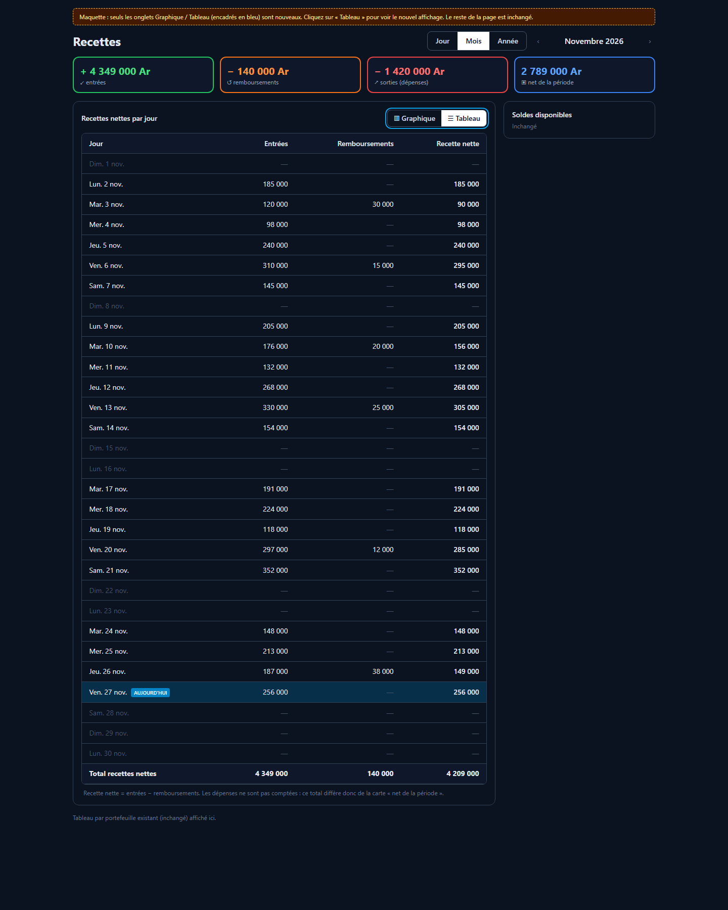
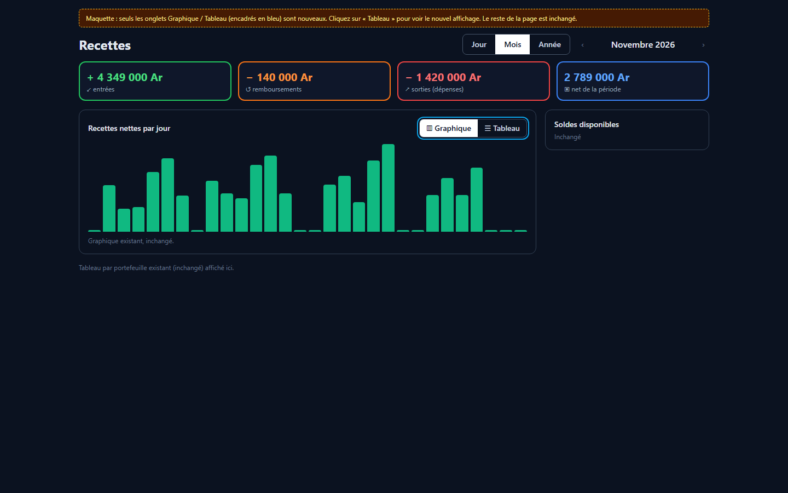

# Tableau des recettes par jour (page Recettes)

Slug : `receipt-daily-table`

Ajouter, sur la page Recettes (`/treasury/receipts`), un onglet **Tableau** à côté du graphique. Il liste les recettes de chaque jour du mois (Jour, Entrées, Remboursements, Recette nette) et, en vue Année, celles de chaque mois.

## Synthèse

### Points compris
- C1 : le besoin est une vue tableau des recettes nettes de chaque jour du mois.
- C2 : le graphique « Recettes nettes par jour » existe déjà et utilise `summary.points`.
- C3 : modes Mois et Année, colonnes Entrées, Remboursements et Recette nette.
- C4 : `ReceiptPoint` doit être étendu (`income`, `refunds`) dans shared et l'API.
- C5 : tous les jours sont affichés, les jours vides en grisé avec « — ».
- C6 : colonne « Recette nette », pied « Total recettes nettes », note précisant que les dépenses ne sont pas comptées.
- C7 : colonne Jour affichée « Lun. 3 nov. », grâce à un champ `date` (AAAA-MM-JJ) dans le point API.
- C8 : le graphique et le tableau sont deux onglets (Graphique par défaut). Le tableau des portefeuilles reste en dessous, inchangé.

### Décisions
- D1 : `ReceiptPoint` gagne `date`, `income` et `refunds`, renseignés dans tous les modes.
- D2 : aucun nouvel endpoint, aucune migration, aucun nouveau rôle.
- D3 : pas d'onglet Tableau en mode Jour.
- D4 : en vue Année, la première colonne s'appelle « Mois » et affiche « Jan », « Fév », etc.

### Hypothèses
- H1 : en vue Année, `date` vaut le premier jour du mois (AAAA-MM-01).
- H2 : le total du pied est la somme des lignes, soit `income − refunds` de la période.
- Q7 : l'onglet choisi est mémorisé pendant la session (signal du composant), sans stockage persistant.

### Améliorations
- Retenues : A1 (surligner aujourd'hui), A2 (opacité pendant le rechargement).
- Rejetée : A5 (meilleur jour).
- Reportée : A4 (export CSV).

### Points de vigilance (tous acceptés)
- V2 : le total diffère de la carte « net de la période » (qui soustrait aussi les dépenses), d'où le libellé et la note.
- V3 : colonne « Mois » en vue Année.
- V4 : `income` et `refunds` renseignés aussi en mode Jour.
- V5 : net négatif en rouge.
- V6 : défilement horizontal sur mobile.
- V7 : tests de `treasury.receipt.spec.ts` à mettre à jour.

### Hors périmètre
Onglet Tableau en mode Jour, export CSV, nouveaux endpoints ou rôles, modification des cartes et du graphique.

## Plan d'implémentation

Ordre : shared, puis API, puis app, puis tests et vérification.

### 1. `@merlebleu/shared`
- Fichier : `packages/merlebleu-shared/src/domain/treasury/receipt.ts`.
- Ajouter à `ReceiptPoint` : `date: string` (AAAA-MM-JJ), `income: number`, `refunds: number`. `amount` reste le net (entrées − remboursements).
- Lancer `npm run generate:barrels` pour vérifier qu'il n'y a aucun changement d'export, puis `npm run build:shared`.
- Motifs : C4, C7, D1, H1, V4.

### 2. API (`@merlebleu/api`)
- Fichier : `packages/merlebleu-api/src/features/treasury/treasury.receipt.ts`, fonction `buildPoints`.
- Jour : une ligne par mouvement, avec `date: row.date`, `income` pour une entrée, `refunds` pour un remboursement (valeur positive, comme dans `buildReceiptSummary`).
- Mois : cumuler `income` et `refunds` par jour, avec la date complète du jour (à partir de `range.from`).
- Année : cumuler par mois, avec `date` = AAAA-MM-01.
- Réutiliser `INCOME_MOVEMENT_TYPES`, `MovementType.REFUND` et `daysInMonth` existants. Aucun changement de controller, de guard, de Swagger ni de migration.
- Risque : les montants de remboursement sont négatifs dans `row.amount` ; les convertir en positifs pour `refunds`, de sorte que `amount = income − refunds`.
- Motifs : C4, C7, D1, D2, V4.

### 3. App (`@merlebleu/ui`)
- Fichiers : `packages/merlebleu-app/src/app/features/treasury/receipt/receipt.ts` et `receipt.html`.
- Ajouter un signal `view` (`chart` | `table`), avec un sélecteur à deux options (`p-selectbutton`, comme le sélecteur de période) placé dans l'en-tête de la carte du graphique.
- Panneau Tableau : `p-table` sur `summary().points`, colonnes Jour/Mois, Entrées, Remboursements, Recette nette. Colonnes numériques en `text-right!`, `tabular-nums`, `min-width` et défilement horizontal (V6).
- Libellé de la colonne Jour : formater `date` en « Lun. 3 nov. » avec `toLocaleDateString('fr-FR', ...)`, en parsant `AAAA-MM-JJ` en date locale (pas de décalage UTC). En vue Année, afficher `label`.
- Lignes vides (entrées et remboursements à 0) grisées avec « — » (C5). Net négatif en `text-red-600 dark:text-red-400` (V5). Ligne du jour surlignée avec une pastille « Aujourd'hui » (A1).
- Pied « Total recettes nettes » (C6) et note sous le tableau. Titre de la carte inchangé (« Recettes nettes par jour / par mois »).
- Appliquer `[class.opacity-60]="loading()"` au panneau (A2). Onglet masqué en mode Jour (D3).
- Réutiliser : `formatAmount` (`formatUnitPrice`), `formatDate`, `TableModule`, `SelectButtonModule`, le style de carte existant. Respecter `docs/angular.md` (signaux, `@if`, Tailwind uniquement).
- Motifs : C3, C5, C6, C8, A1, A2, V2, V3, V5, V6, Q7.

### 4. Tests
- Jest : mettre à jour `packages/merlebleu-api/src/features/treasury/treasury.receipt.spec.ts` (lignes 156 à 183) pour couvrir `date`, `income` et `refunds` dans les trois modes (V7).
- Jest : test de cohérence, la somme des `amount` des points égale `income − refunds` du résumé (H2).
- Karma/Jasmine : nouveau `receipt.spec.ts` du composant (bascule d'onglet, jours vides en « — », net négatif, ligne du jour, onglet masqué en mode Jour).
- e2e API : aucun nouvel endpoint, donc pas de nouveau test e2e.

### 5. Vérification
- `npm run build:shared`, `npm run build`, `npm run lint`, `npm test`.
- Test manuel dans le navigateur sur `/treasury/receipts` : modes Mois et Année, thème clair et sombre, largeur mobile, mois sans mouvement, remboursement un jour sans entrée.

### Ordre d'exécution et risques
1. shared, 2. API, 3. app, 4. tests, 5. vérification.
- Fuseau horaire : parser `date` en local.
- Les montants de remboursement doivent rester cohérents entre `buildReceiptSummary` et `buildPoints`.

## Maquettes finales

Maquette HTML (source de vérité) : `mockups/receipts-daily-table.html`
Aperçu interactif (potentiellement éphémère) : https://claude.ai/artifact/4ULhpzQGqCpqHCaDLnPNLZ

### Onglet Tableau (vue Mois, thème sombre)

### Onglet Graphique (par défaut)

Notes : le bandeau ambre et l'encadré bleu de la maquette ne font pas partie de l'application.
