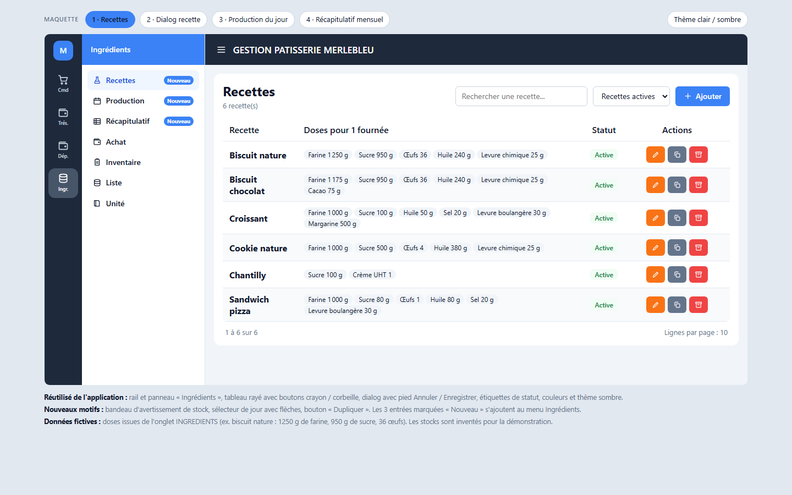
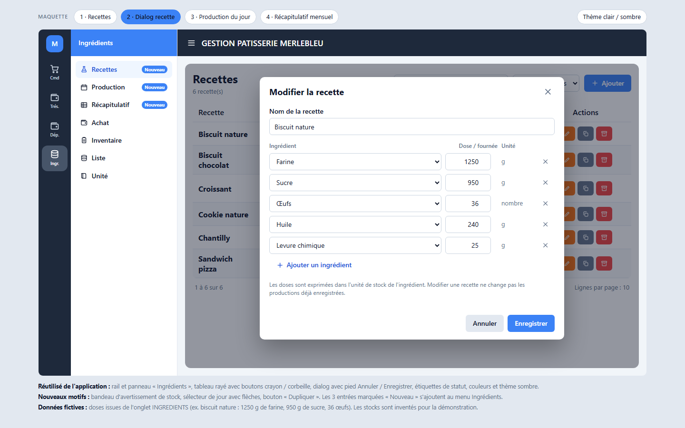
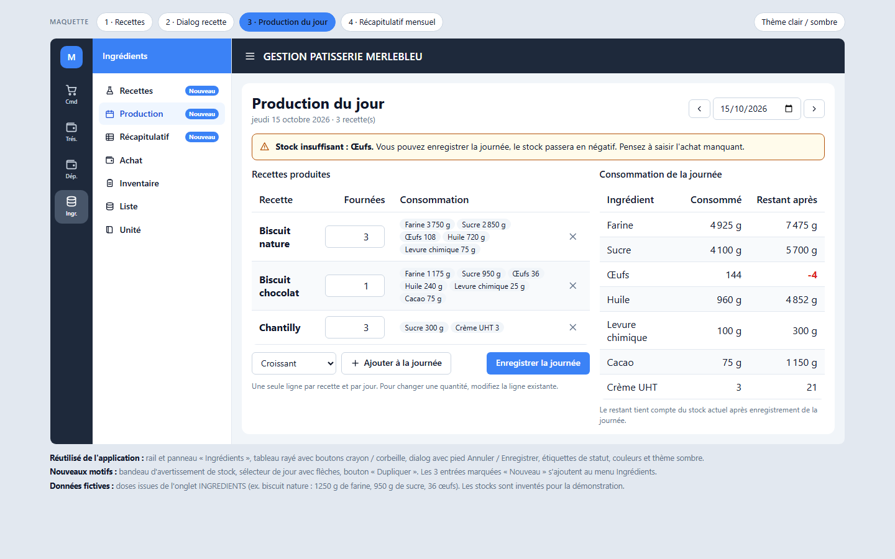
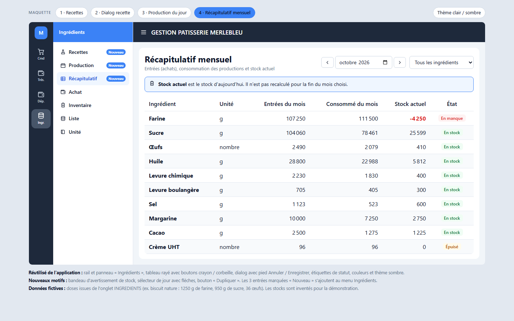

# Recettes et production quotidienne des ingrédients

Slug : `recipe-production`

Reproduire dans l'application l'onglet INGREDIENTS du fichier `docs/TSENA OCT 2026.xlsx`. On définit des **recettes** (doses d'ingrédients pour une fournée), on saisit chaque jour les **fournées produites**, et l'application calcule la consommation, met à jour le stock et affiche les restes.

## Ce que fait l'Excel aujourd'hui

- 25 préparations (BISCNAT, BISCCHO, CROISS, PAINC, CAKER, COOKIN, CHANTI, GELEE…) et 16 ingrédients en colonnes (farine, sucre, œufs, huile, sel, levures, margarine, beurre, lait en poudre, cacao, chocolat, PCP, gélatine, raisins secs, crème).
- Un bloc de 26 lignes par jour sur 31 jours (lignes 3 à 808). La recette est recopiée dans chaque bloc : environ 800 lignes dupliquées.
- Consommation = fournées × dose (ex. biscuit nature : 1250 g de farine, 950 g de sucre, 36 œufs, 240 g d'huile, 25 g de levure chimique).
- Les totaux mensuels sont en ligne 810. L'onglet STOCKS en déduit les restes. Plusieurs restes sont négatifs sans alerte (farine −4 250 g, raisins secs −1 200 g).
- Des variantes de recette ont dérivé d'un jour à l'autre (CRMPAT, SAUCE).
- Conversions codées dans les formules : 1 sac = 50 kg, 1 bouteille d'huile = 900 g, 1 chocolat = 11 g.

## Existant réutilisé

- `Ingredient` (stock, unité) : [ingredient.entity.ts](../../../packages/merlebleu-api/src/features/ingredient/ingredient.entity.ts).
- `IngredientPurchase` incrémente déjà le stock, ce sont les « ENTREES » de l'Excel : [ingredient-purchase.service.ts](../../../packages/merlebleu-api/src/features/ingredient/purchase/ingredient-purchase.service.ts).
- Page Inventaire pour fixer le stock de départ : `packages/merlebleu-app/src/app/features/ingredient/inventory/`.
- Schémas Zod partagés + `createZodDto` : [ingredient-purchase.dto.ts](../../../packages/merlebleu-shared/src/domain/ingredient/purchase/ingredient-purchase.dto.ts), [ingredient.dto.ts](../../../packages/merlebleu-api/src/features/ingredient/ingredient.dto.ts).
- Base : `synchronize: true` ([app.module.ts:30](../../../packages/merlebleu-api/src/app.module.ts#L30)), donc pas de migration.

## Synthèse

### Points compris
- C1 : une recette = des doses par ingrédient pour une fournée.
- C2 : une production du jour = date + fournées par recette.
- C3 : la consommation = fournées × doses, calculée automatiquement.
- C4 : la saisie quotidienne remplace les 800 lignes recopiées.
- C5 : les recettes forment une entité distincte de `Item` (pas de prix, pas vendues).
- C6 : le stock est la source unique : achats (+), productions (−).
- C7 : les quantités produites sont des fournées décimales (0,75 ; 0,34).
- C8 : périmètre = recettes, production quotidienne, consommation et stocks restants.

### Décisions
- D1 : consommation figée à l'enregistrement (chaque production mémorise ce qu'elle a consommé).
- D2 : doses dans l'unité du stock de l'ingrédient, sans conversion.
- D3 : stock négatif autorisé, avec avertissement.
- D4 : une seule ligne par recette et par jour.

### Hypothèses
- H1 : pâte feuilletée (onglet PATE) et import des données Excel sont hors périmètre.
- H2 : le stock actuel est correct avant la première production (à fixer via l'Inventaire).
- H3 : le récapitulatif mensuel affiche entrées (achats du mois), consommé (productions du mois) et stock actuel (celui d'aujourd'hui).
- H4 : les noms complets des recettes sont saisis par l'utilisateur.
- H5 : aucun nouveau rôle ni guard spécifique.

### Améliorations
- Retenue : A1 dupliquer une recette.
- Reportées : A2 copier la production de la veille, A3 export Excel du récapitulatif.
- Rejetée : A4 coût de revient (aucun prix d'achat dans l'application).

### Points de vigilance
- V1 : unités hétérogènes (œufs en nombre, huile en grammes). Les doses suivent l'unité du stock.
- V2 : modifier une recette ne réécrit pas l'historique.
- V3 : stock négatif signalé mais autorisé.
- V4 : recette utilisée = archivée (jamais supprimée) ; ingrédient utilisé dans une recette = suppression refusée.
- V5 : création, modification et suppression d'une production en transaction, stock ajusté de façon atomique dans les deux sens.
- V6 : validation Zod stricte : fournées > 0 (2 décimales max), au moins un ingrédient, pas de doublon, dose > 0.
- V7 : états vide / chargement / erreur, tableaux défilables sur mobile.
- V8 : `synchronize: true` et base partagée entre worktrees : aucune table ni colonne existante n'est modifiée.

### Hors périmètre
Pâte feuilletée, import Excel, coût de revient, conversions d'unités, recettes imbriquées, lien recette ↔ article vendu (`Item`), export, copie de la veille.

## Maquettes finales

Aperçu interactif (privé, potentiellement éphémère) : https://claude.ai/artifact/8cavwUWQCJxJnPTdEeoxUh. Les fichiers du repo font foi : `mockups/recipe-production.html` et les PNG ci-dessous.

| Écran | Maquette |
|---|---|
| Recettes (liste) |  |
| Dialog recette |  |
| Production du jour |  |
| Récapitulatif mensuel |  |

Nouveaux motifs visuels (absents de l'application) : bandeau d'avertissement de stock, navigation par flèches de jour, bouton Dupliquer. Le reste reprend les composants existants.

## Plan d'implémentation

Ordre : shared → API → app → tests → vérification.

### 1. `@merlebleu/shared`
Motifs : C1, C2, C7, D1, D2, D4, V6.
- `src/domain/ingredient/recipe/recipe.ts` : `Recipe { id, name, isActive, lines: RecipeLine[] }`, `RecipeLine { ingredient: Ingredient, quantity }`.
- `src/domain/ingredient/recipe/recipe.dto.ts` : `createRecipeSchema` (nom non vide ; `lines` ≥ 1 ; chaque ligne `ingredientId: z.uuid()`, `quantity` positive ; refus des doublons d'`ingredientId`), `updateRecipeSchema` identique. Modèle : [ingredient-purchase.dto.ts](../../../packages/merlebleu-shared/src/domain/ingredient/purchase/ingredient-purchase.dto.ts).
- `src/domain/ingredient/production/production.ts` : `Production { id, productionDate, recipe, quantity, consumptions: ProductionConsumption[] }`, `ProductionConsumption { ingredient, quantity }`.
- `src/domain/ingredient/production/production.dto.ts` : `createProductionSchema` (`productionDate`, `recipeId`, `quantity` positive, 2 décimales max) ; `updateProductionSchema` (quantité seule).
- `src/domain/ingredient/summary/ingredient-summary.ts` : `IngredientMonthSummary { ingredient, entries, consumed, currentStock }`.
- Lancer `npm run generate:barrels` puis `npm run build:shared`.
- Risque : aucun changement sur les DTO existants (rétro-compatible).

### 2. API (`@merlebleu/api`)
Motifs : C5, C6, D1, D3, D4, V4, V5, H3, H5. Dossier `src/features/ingredient/`.
- `recipe/` : entités `RecipeEntity` (`recipes`) et `RecipeLineEntity` (`recipe_lines`, relation vers `IngredientEntity`, `onDelete: RESTRICT`), service, contrôleur, module.
  - Routes : `GET /recipe` (filtres `labelContains`, `isActive`), `POST`, `PUT /:id`, `PATCH /:id/archive`, `PATCH /:id/restore`, `POST /:id/duplicate`.
  - Pas de suppression physique si la recette est utilisée.
- `production/` : entités `ProductionEntity` (`productions`, unicité `(productionDate, recipe)`) et `ProductionConsumptionEntity` (`production_consumptions`, quantités figées).
  - **Réalisé** : `PUT /production/day` remplace toutes les productions d'un jour (la maquette a un seul bouton « Enregistrer la journée »). Dans une transaction (`DataSource.transaction`), il rend d'abord le stock des consommations figées du jour, supprime les anciennes productions, calcule `dose × quantité` pour chaque ligne, enregistre les consommations puis décrémente `stock` de façon atomique. Une liste vide vide la journée. Cela remplace les routes `POST`, `PUT /:id` et `DELETE /:id` prévues initialement.
  - `GET /production?date=AAAA-MM-JJ` : productions du jour avec leurs consommations figées.
  - La réponse de `PUT /production/day` contient `shortages` (ingrédients dont le stock est négatif).
  - Le stock négatif n'est pas refusé (D3). La réponse renvoie la liste des ingrédients en manque, pour le bandeau.
- `GET /ingredient/summary?month=AAAA-MM` : entrées (somme des achats du mois), consommé (somme des consommations du mois), stock actuel. Modèle d'agrégation : [treasury.sql.ts](../../../packages/merlebleu-api/src/features/treasury/treasury.sql.ts).
- `ingredient.service.ts` : `deleteIngredient` renvoie un conflit (409, message en français) si l'ingrédient est utilisé dans une recette.
- Enregistrer les nouveaux modules dans `ingredient.module.ts`. DTO via `createZodDto`, décorateurs Swagger.
- Risques : arrondis `decimal(10,2)` pour les fournées décimales ; modification d'une production quand la recette a changé (D1 : le recalcul utilise la recette courante, c'est un choix à documenter dans Swagger).

### 3. App (`@merlebleu/ui`)
Motifs : C2, C3, D3, A1, V4, V7. Dossier `src/app/features/ingredient/`.
- Routes lazy-loaded `recipe`, `production`, `summary` dans [ingredient.routes.ts](../../../packages/merlebleu-app/src/app/features/ingredient/ingredient.routes.ts).
- Menu : 3 entrées dans la section « Ingrédients » de [app-layout.ts](../../../packages/merlebleu-app/src/app/app-layout.ts) (Recettes, Production, Récapitulatif), avec les icônes `pi pi-flask`, `pi pi-calendar` et `pi pi-table`.
- `recipe/` : page liste + dialog (`p-dialog` + formulaire de lignes), calquée sur `purchase/` et `ingredient/`. Actions Modifier, Dupliquer, Archiver.  
- `production/` : sélecteur de jour, tableau des lignes avec saisie de fournées, consommation calculée côté client avec les doses de la recette (aperçu) et confirmée par l'API, bandeau de stock insuffisant. 
- `summary/` : sélecteur de mois, tableau par ingrédient, filtre « en manque ». 
- Erreurs : interceptors existants (`httpErrorInterceptor`, toast PrimeNG). États vide / chargement / erreur sur chaque tableau, `overflow-x` sur mobile.
- Réutiliser : `capitalizeFirstLetter` (`@shared/utils/text`), `IngredientService` pour la liste d'ingrédients, composants PrimeNG déjà utilisés (`TableModule`, `DialogModule`, `SelectModule`, `InputNumberModule`, `TagModule`).
- Risque : formulaire à lignes dynamiques (pas d'équivalent existant) ; garder un état simple (tableau de signaux).

### 4. Tests
- API (Jest) : service de production (calcul des consommations, décrément du stock, stock négatif accepté, modification, suppression, unicité date + recette) ; service de recette (doublon d'ingrédient, archivage, duplication) ; refus de suppression d'un ingrédient utilisé ; agrégation du récapitulatif.
- App (Karma) : composants recette et production (calcul de l'aperçu, bandeau de stock, validation du formulaire).
- e2e API : cycle créer / modifier / supprimer une production et vérification du stock à chaque étape.

### 5. Vérification
- `npm run build:shared`, `npm run build`, `npm run lint`, `npm test`.
- Test manuel dans le navigateur : créer 2 recettes, saisir une journée avec stock insuffisant (bandeau visible), enregistrer, vérifier le stock sur la page Inventaire et le récapitulatif, modifier puis supprimer la production et revérifier le stock.

### Ordre d'exécution et dépendances
1 → 2 → 3 (3 dépend des types de 1 et des endpoints de 2). Les tests de l'API se rédigent avec l'étape 2, ceux de l'app avec l'étape 3.

## Suite

Lancer le skill `implement-feature` avec ce plan.
