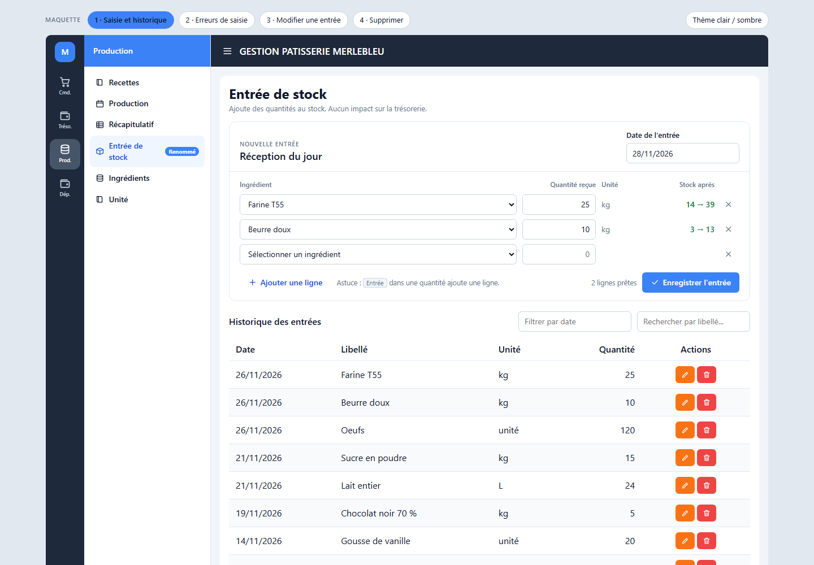
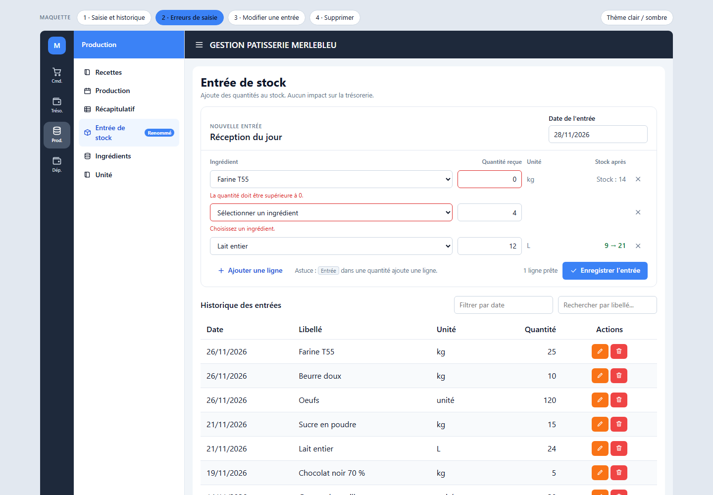
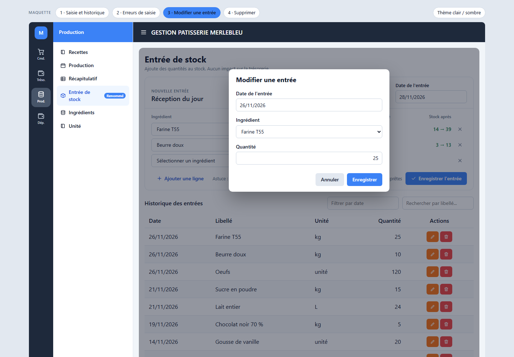
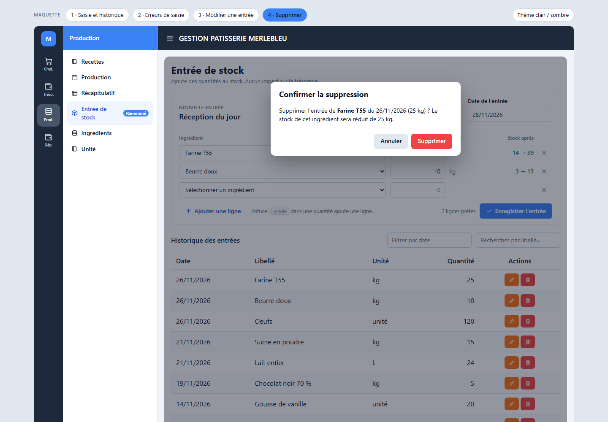

# Refonte de l'entrée de stock

Remplacer la saisie « achat d'ingrédient » (un dialog par ingrédient) par une **entrée de stock** simple, saisie en lot, sans effet financier.

## Synthèse

### Points compris
- **C1** : le problème principal est un dialog par ingrédient ; il faut saisir plusieurs ingrédients d'un coup.
- **C2** : un seul utilisateur, sur ordinateur, avec une saisie optimisée pour le clavier.
- **C3** : une entrée de stock n'est pas un achat et n'a aucun effet financier. La dépense est déjà saisie dans la Grille du mois.
- **C4** : aujourd'hui l'achat n'a déjà ni prix ni lien avec les wallets. Le changement porte sur le vocabulaire et l'écran, pas sur le comportement financier.

### Décisions
- **C5** : saisie en lot par lignes dynamiques (ingrédient + quantité), avec une date commune.
- **C6** : la table et l'API sont renommées (`ingredient_purchases` → `stock_entries`, route `/ingredient/stock-entry`).
- **C7** : l'historique reste sous la saisie, avec filtres, modification et suppression.
- **C8** : l'enregistrement d'un lot est transactionnel.
- Le renommage de la table passe par un script SQL manuel documenté.

### Hypothèses
- **H1** : les noms `stock_entries` et `/ingredient/stock-entry` sont ceux proposés.
- **H2** : le menu s'appelle « Entrée de stock », le récapitulatif dit « Entrées ».
- **H3** : pas de plafond métier sur le nombre de lignes, limite technique de 100.
- **H4** : pas de type d'entrée (don, ajustement), toutes les entrées sont de même nature.

### Hors périmètre
- Prix, fournisseur, moyen de paiement, lien avec la trésorerie.
- Type d'entrée, import CSV, code-barres.
- Vrai système de migrations.
- Mobile et gestion de rôles.

## Registre final

| ID | Type | Point |
|---|---|---|
| C1-C8 | Compris | voir ci-dessus |
| A1 | Amélioration (retenue) | Date par défaut = aujourd'hui |
| A2 | Amélioration (retenue) | Pas de doublon d'ingrédient dans un lot |
| A3 | Amélioration (retenue) | Unité et stock avant/après par ligne |
| A4 | Amélioration (retenue) | Toast avec le nombre de lignes, formulaire réinitialisé |
| A5 | Amélioration (retenue) | Validation Zod avec un message par ligne |
| A6 | Amélioration (retenue) | Tests Jest du lot transactionnel |
| V1 | Vigilance | Alternative « grille de tous les ingrédients » écartée au profit des lignes dynamiques |
| V2 | Vigilance | Écriture ligne + stock aujourd'hui non transactionnelle |
| V3 | Vigilance | Base partagée entre worktrees |
| V4 | Vigilance | Double validation d'un même lot |
| V5 | Vigilance | Correction d'une erreur de saisie via l'historique |
| V6 | Vigilance | Vocabulaire « achat » à aligner partout |
| V7 | Vigilance | `synchronize: true` créerait une table vide, historique perdu sans script SQL |
| V8 | Vigilance | Anciens DTO partagés supprimés, seuls l'app et l'API les utilisent |
| V9 | Vigilance | Menu, récapitulatif et libellés alignés |

## Plan d'implémentation

### 1. `@merlebleu/shared` (C3, C6, A5, V8)
- Renommer `src/domain/ingredient/purchase/` en `src/domain/ingredient/stock-entry/`.
- Types : `StockEntry`, `CreateStockEntriesDto` (date + `lines[]`, 1 à 100 éléments), `UpdateStockEntryDto`. Schéma Zod avec un message par ligne.
- Retirer les anciens exports de `src/index.ts`, puis `npm run generate:barrels`.

### 2. API (C6, C8, V2, V3, V7)

- Renommer `features/ingredient/purchase/` en `stock-entry/` ; l'entité pointe sur `stock_entries`.
- `createStockEntries` : une transaction qui insère les lignes puis incrémente le stock ; rollback et 404 si un ingrédient est inconnu.
- `update` et `delete` : même logique de delta, dans une transaction.
- Endpoint `POST /stock-entries` en lot, Swagger mis à jour.
- Mettre à jour `ENTRIES_SQL` dans `summary/ingredient-summary.service.ts` et `ingredient.module.ts`.
- Documenter et fournir le script SQL : `ALTER TABLE ingredient_purchases RENAME TO stock_entries;`, à exécuter une fois avant de lancer l'API.
- Risques : table vide si le script n'est pas lancé ; autres worktrees à prévenir.

### 3. App (C1, C5, C7, A1-A4, V4, V5, V6, V9)

- Renommer `features/ingredient/purchase/` en `stock-entry/` ; route `stock-entry` dans `ingredient.routes.ts`.
- Menu : « Achat » devient « Entrée de stock » (`app-layout.ts`).
- Nouveau composant de saisie en lot : lignes en signals, Entrée ajoute une ligne, ingrédients déjà choisis exclus, unité et stock avant/après, bouton désactivé pendant l'envoi.
- Historique et dialogs de modification et de suppression repris de l'existant (`appendTo="body"` sur chaque `p-select` dans un dialog).
- `summary.html` : « Entrées (achats) » devient « Entrées ».
- Réutiliser : `purchase-form.component`, `getPageFromFirstRows`, `capitalizeFirstLetter`, `httpErrorInterceptor` (pas de `error` dans `.subscribe()`).
- Nouveau pattern : le bloc de saisie en ligne au-dessus du tableau (inspiré de la section bordée de la page Ingrédients).

### 4. Tests (A6)
- Jest : lot transactionnel, rollback si ingrédient inconnu, delta à la modification et à la suppression.
- Karma : composant de saisie en lot (ajout et retrait de ligne, exclusion des doublons, validation).
- e2e API : `POST /stock-entries`.

### 5. Vérification
- Lint et build.
- Exécuter le script SQL sur la base de dev.
- Smoke test navigateur : lot de 3 lignes, stock et récapitulatif mensuel, modification et suppression d'une entrée.

## Maquettes finales

Les PNG et HTML du repo font foi ; le lien Artifact est un aperçu interactif potentiellement éphémère : https://claude.ai/artifact/9bxg2VyuJwmQ35V22BupMG

| Écran | Image |
|---|---|
| Saisie et historique |  |
| Erreurs de saisie |  |
| Modifier une entrée |  |
| Supprimer |  |

Source HTML : `mockups/stock-entry.html`
