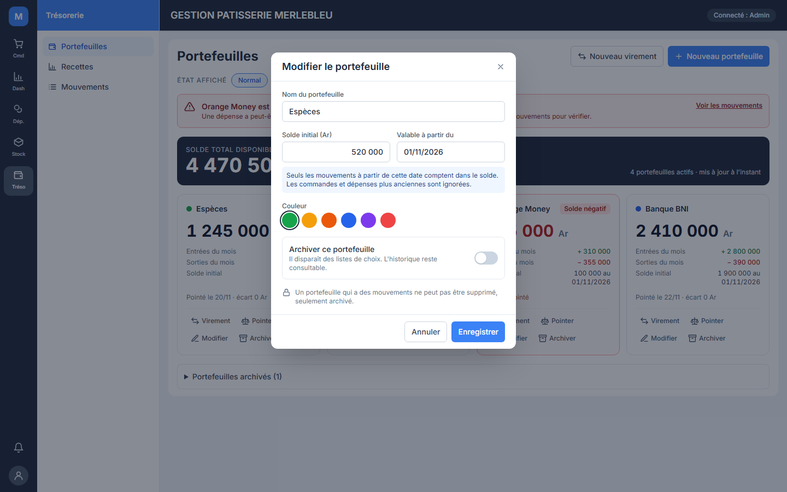
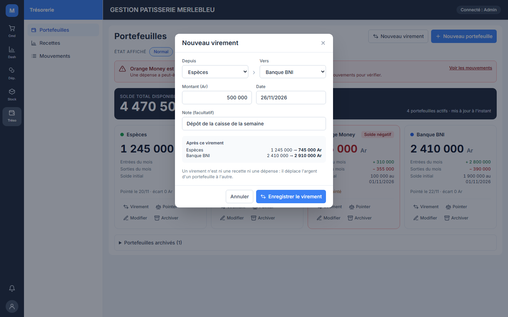
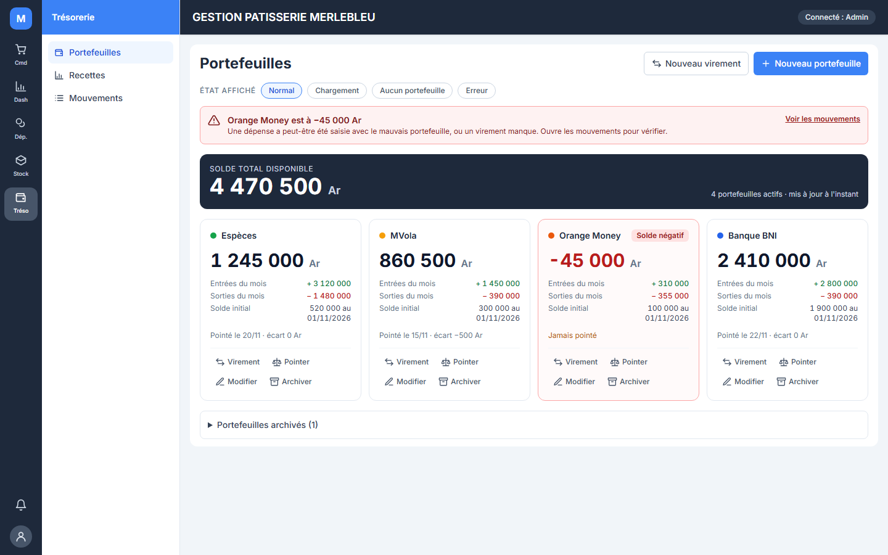
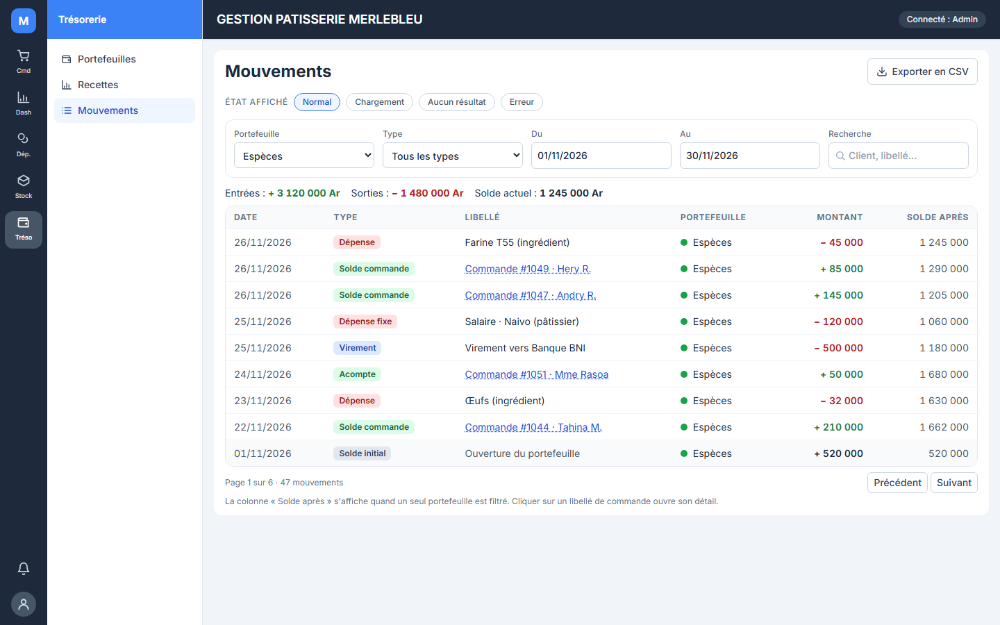
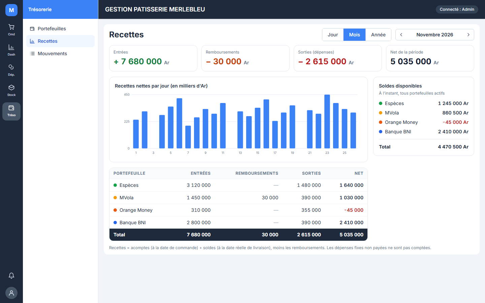
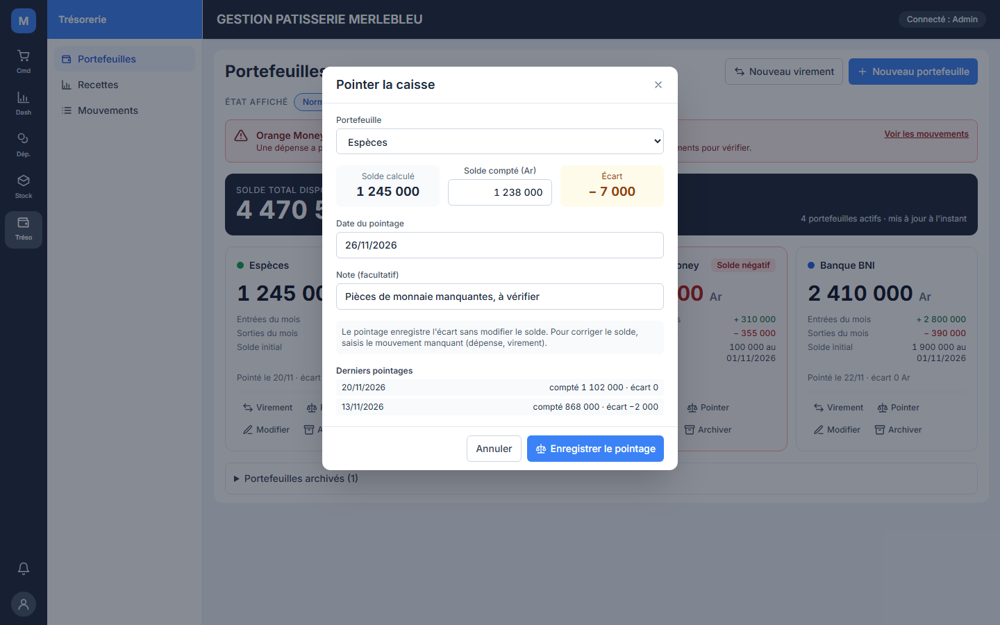
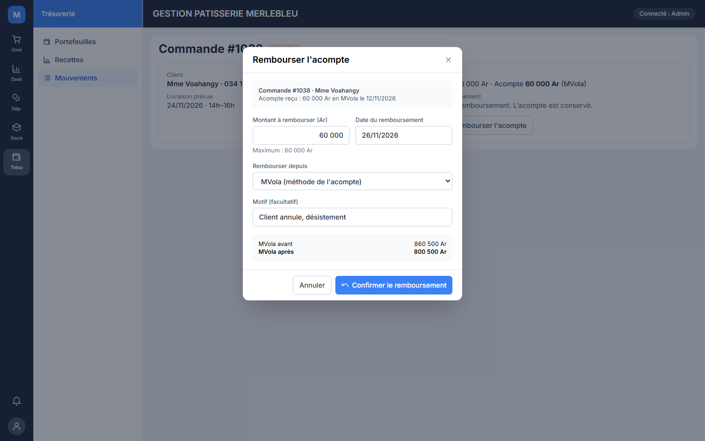
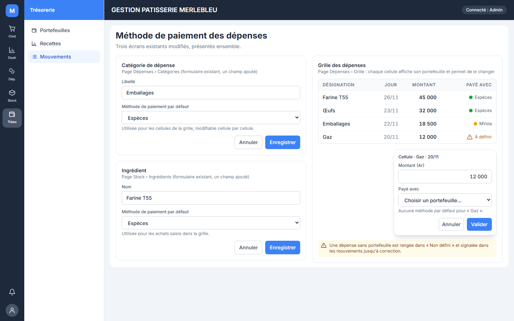

# Trésorerie : flux financiers par portefeuille

Tracer les entrées d'argent (commandes) et les sorties (dépenses) par méthode de paiement, vue comme un portefeuille. Consulter le solde de chaque portefeuille et les recettes par jour, mois et année.

Slug : `treasury`. Maquettes : `mockups/`. Toutes les valeurs sont en Ariary (entiers, sans décimales).

## 1. Synthèse

### Points compris
- **C1** : une commande génère des entrées d'argent (acompte puis solde) et une dépense génère une sortie.
- **C2** : chaque mouvement est lié à une méthode de paiement, qui devient un portefeuille.
- **C3** : on veut un solde par portefeuille et des recettes par jour, mois et année.
- **C4** : les méthodes de paiement existent déjà (`id`, `name`, `color`) et sont déjà liées aux commandes (`paymentMethod`, `balancePaymentMethod`) et aux dépenses.
- **C5** : un portefeuille a un solde initial daté, et les virements entre portefeuilles sont tracés.
- **C6** : tous les rôles consultent soldes, recettes et mouvements.
- **C7** : l'acompte est comptabilisé à `orderDate`, le solde à la livraison.
- **C8** : les dépenses variables prennent une méthode par défaut (par catégorie ou ingrédient), modifiable par cellule.

### Décisions
- **D1** : solde initial daté par portefeuille, seuls les mouvements à partir de cette date comptent. Virements tracés.
- **D2** (révisée en validation des maquettes) : tous les rôles voient tout, y compris le libellé des dépenses. Aucun masquage pour le caissier.
- **D3** : seul `ADMIN` écrit (solde initial, virements, portefeuilles, archivage, pointages, remboursements). L'écriture des méthodes de paiement est aussi restreinte à `ADMIN`. La lecture reste ouverte.
- **D4** : acompte à `orderDate`, solde à sa date réelle de paiement.
- **D5** : méthode par défaut sur chaque catégorie de dépense et chaque ingrédient, modifiable cellule par cellule dans la grille.
- **D6** : vue calculée, sans registre figé. Seuls solde initial, virements, remboursements et pointages sont stockés.
- **D7** : l'acompte d'une commande annulée est conservé, sauf remboursement explicite.

### Hypothèses confirmées
- **H1** : colonne nullable `Order.balancePaidDate`, renseignée par `deliverOrder`. Repli sur `deliveryDate` pour l'existant.
- **H2** : une dépense variable sans méthode tombe dans « Non défini », signalé jusqu'à correction.
- **H3** : une dépense fixe avec `paid = false` n'impacte pas le solde.
- **H4** : le solde initial vaut en début de journée. Les mouvements de ce jour et suivants comptent.
- **H5** : recettes = entrées (acomptes + soldes) moins remboursements. L'écran montre aussi sorties et net par portefeuille.
- **H6** : un pointage enregistre le solde compté à une date. L'historique est conservé, l'écart est calculé par rapport au solde à cette date, sans modifier le solde.
- **H7** : l'export CSV porte sur les mouvements filtrés.
- **H8** : nouvelles colonnes nullables ou avec valeur par défaut (`synchronize: true`). Montants entiers.

### Améliorations
- **Retenues** : A1 archivage de portefeuille, A2 liste des mouvements filtrable, A3 remboursement explicite, A4 dépenses fixes impayées non comptabilisées, A5 alerte de solde négatif, A6 export CSV, A7 pointage de caisse.
- **Rejetées** : aucune.
- **Reportées** : aucune.

### Points de vigilance
- **V1** : les dépenses variables sans méthode empêchent un solde fiable. Traité par D5 et H2.
- **V2** : l'historique n'a pas de méthode fiable. Traité par le solde initial daté.
- **V3** : la date du paiement du solde n'est pas stockée. Traité par H1.
- **V4** : une vue calculée ne conserve pas l'historique d'une modification passée (V13).
- **V5** : l'écriture est limitée à `ADMIN`.
- **V6** : l'annulation avec acompte est traitée par D7 et A3.
- **V7** : un portefeuille qui a des mouvements n'est pas supprimable, seulement archivable.
- **V8** : le caissier lit des libellés de dépenses que `ExpenseController` lui interdit. Accepté (D2).
- **V9** : `PaymentController` n'a aucun `@Roles` aujourd'hui. À restreindre pour l'écriture.
- **V10** : `synchronize: true` et base partagée entre worktrees. Pas de migration versionnée.
- **V11** : montants entiers comme le reste de l'app.
- **V12** : périmètre large (A5, A6, A7). Livrer le cœur d'abord.
- **V13** : modifier une commande ou une dépense passée change immédiatement les soldes historiques. Pas d'audit.

### Hors périmètre
- Achats d'ingrédients (`ingredient_purchases` n'a aucun montant).
- Frais de virement, devises multiples, rapprochement bancaire automatique.
- Journal d'audit des modifications.

## 2. Plan d'implémentation

### Étape 1. `@merlebleu/shared`
Motivé par : C5–C8, D1, D6, D7, A1, A3, A7, H1.

- Créer `src/domain/treasury/{wallet,transfer,refund,cash-count,movement,receipt}` : types, DTO, schémas Zod. Enum `MovementType` : acompte, solde commande, dépense, dépense fixe, remboursement, virement, solde initial.
- Étendre `PaymentMethod` (`src/domain/sale/payment/payment.ts`) avec `openingBalance`, `openingDate`, `archived`.
- Ajouter `Order.balancePaidDate`, `defaultPaymentMethod` sur `ExpenseCategory` et `Ingredient`, et `paymentMethodId` optionnel dans `SetExpenseCellDto`.
- Lancer `npm run generate:barrels`.
- À réutiliser : `domain/shared/pagination.ts`, `domain/sale/dashboard/dashboard.dto.ts`.
- Maquettes :  

### Étape 2. API (`@merlebleu/api`)
Motivé par : D3–D7, A1–A7, V1, V2, V7, V9, V10.

- Module `features/treasury/` avec entités (virement, remboursement, pointage), services, contrôleurs, Swagger et DTO `nestjs-zod`.
- Soldes calculés en SQL. Mouvements par `UNION ALL` sur quatre sources :
  - acompte : `paidAmount − balancePaidAmount` à `orderDate` sur `paymentMethod`, commandes annulées incluses ;
  - solde : `balancePaidAmount` d'une commande `DELIVERED` à `COALESCE(balancePaidDate, deliveryDate)` sur `balancePaymentMethod` ;
  - dépenses : toutes les variables, et les fixes seulement si `paid = true` ;
  - virements (deux jambes), remboursements et solde initial.
- Filtre : seuls les mouvements à partir de `openingDate` du portefeuille. Dépense sans méthode dans « Non défini ».
- Endpoints : `GET /treasury/wallets`, `/movements`, `/movements/export` (CSV), `/receipts?view=day|month|year`, ouverts à tous les rôles. Les `POST` (virement, remboursement, pointage) et l'écriture des portefeuilles sont en `@Roles(UserRole.ADMIN)`.
- Modifier :
  - `order.service.ts:428` (`deliverOrder`) pour renseigner `balancePaidDate` ;
  - `expense.service.ts:58` (`setCell`) pour appliquer la méthode par défaut ou celle choisie ;
  - `payment.controller.ts` : `@Roles(ADMIN)` sur `POST`, `PUT`, `DELETE` ;
  - `payment.service.ts:48` : refuser la suppression d'un portefeuille avec mouvements.
- Période : réutiliser `features/sale/dashboard/dashboard.period.ts`.
- Risque : colonnes nullables obligatoires, base partagée entre worktrees.
- Maquettes :  

### Étape 3. App (`@merlebleu/ui`)
Motivé par : C3, D2, A2, A5, A6, A7.

- Ajouter la section « Trésorerie » dans `app-layout.ts`, avec routes lazy-loaded `treasury/{wallets,receipts,movements}`.
- Pages : portefeuilles (cartes, alerte de solde négatif), recettes (période, KPI, graphique, tableau, panneau des soldes), mouvements (filtres, pagination, export CSV).
- Dialogs : portefeuille, virement, pointage, remboursement. Bouton « Rembourser l'acompte » dans `order-detail-dialog.ts` pour une commande annulée (Admin).
- Formulaires existants : `category-form.component.ts`, `ingredient-form.component.ts` et `expense-grid.ts` (champ « méthode par défaut » et choix du portefeuille par cellule).
- À réutiliser : `stat-card`, `month-switcher`, `p-table`, `MessageService`, `httpErrorInterceptor`, `dashboard-chart.utils.ts`.
- Les actions Admin sont masquées pour les autres rôles.
- Maquettes :    

### Étape 4. Tests
- Jest (API) : chaque source de mouvement, date d'ouverture, dépense fixe impayée, annulation avec et sans remboursement, bornes jour/mois/année, rôles des contrôleurs.
- Karma/Jasmine (app) : composants et services.
- e2e API : parcours commande, solde, dépense.

### Étape 5. Vérification
Lint, build du shared puis de l'API et de l'app. Test manuel et smoke test navigateur.

### Ordre de livraison (V12)
1. Cœur : solde initial, soldes, mouvements, recettes, méthodes par défaut.
2. Virements, remboursements, archivage.
3. Pointage et export CSV.

### Risques
- Date du solde (H1) pour les commandes déjà livrées.
- Dépenses variables passées sans méthode (V2).
- Fuseaux horaires dans `formatDate`.

## 3. Maquettes finales

Toutes validées. Version interactive : https://claude.ai/artifact/QrCSwCJwsLeR3PkFrGGqP4

